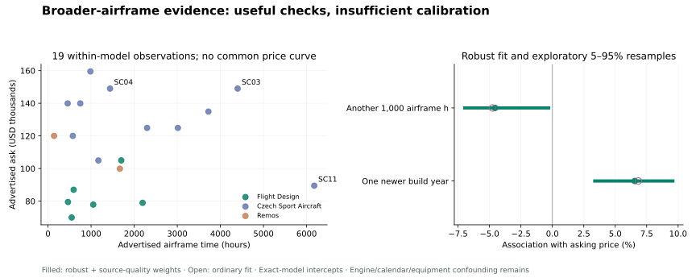

# Broader-airframe curve review — 18 October 2026

**Decision:** use other aircraft to challenge the model, and component prices to improve cost references. Do **not** import their absolute prices, fitted age/hour slopes, or equipment premiums into the Virus/Sinus estimate. The external sample does not separate those effects reliably enough.

The production changes are limited to engine-specific cost references and continuous parachute-service allowances. Engine service year and parachute repack year now have interactive curves. The original target corpus, variant anchors, age/hour priors and equipment premiums are unchanged. This is an improvement in provenance and behavior, **not demonstrated predictive accuracy**.

## What was reviewed

[Aircraft evidence](aircraft-evidence.json) records **29** original seller/dealer advertisements or reviewed exclusions across Flight Design, SportCruiser, Remos and Tecnam. **24** have usable ordinary asking-price/year/time records for exploratory diagnostics. Only **19**, in four exact model groups, have another same-model observation and can inform the within-model slopes:

| Exact model group | Aircraft | Why the grouping matters |
| --- | ---: | --- |
| Flight Design CTSW | 4 | Does not share an intercept with CTLS, CTLSi or F2 |
| Flight Design CTLS | 2 | Turbo CTLS is separate; engine subtype is not filled in where absent |
| SportCruiser | 11 | Engine replacements, training use and panel changes complicate TTAF |
| Remos GX | 2 | G3/600 is separate |

Five isolated model/configuration records remain documented but cannot identify a slope when each model has its own price intercept. Non-US prices were considered during discovery but not mixed into this USD/US diagnostic sample. Factory-new quotations are not treated as used-aircraft transactions. A “sold” label retains the **last ask**, never an invented closing price.

This is a convenience sample of publicly accessible ads, not a census, random sample or panel tracking the same aircraft through time. Unsold inventory, broker pricing, unknown identities and sparse service history limit interpretation. Some listings may no longer be available. Engine hours, actual flight TTIS and Hobbs are separate fields; absent facts stay null.

## Conflicts and unusual observations

- **Hobbs versus airframe time:** [N627SX](https://www.controller.com/listing/for-sale/258030705/2017-czech-sport-aircraft-sportcruiser-light-sport-aircraft) headlines 4,656.2 but explicitly gives 3,721.8 airframe TTIS; [N275SC](https://www.controller.com/listing/for-sale/258033001/2017-czech-sport-aircraft-sportcruiser-light-sport-aircraft) headlines 3,819.1 but gives 3,014.3 TTIS. The fit uses the explicitly identified airframe time.
- **Replacement engines confound airframe wear:** [N587SC](https://www.controller.com/listing/for-sale/256645145/2019-czech-sport-aircraft-sportcruiser-light-sport-aircraft) and [N658SC](https://www.controller.com/listing/for-sale/253308379/2019-czech-sport-aircraft-sportcruiser-light-sport-aircraft) both ask $149,000. Their airframe times are 4,400 and 1,440 hours; engine times are 575 and 1,440. They also have different navigators. This is not evidence that airframe hours have zero cost.
- **A low ask is not automatically a bad observation:** the $89,500, 6,177-hour SportCruiser remains in the diagnostic fit. Its corrected engine-log omission receives a disclosed documentation weight and is covered by sensitivity analysis. Its price alone is not an exclusion rule.
- **A different sale proposition is not ordinary depreciation:** [N427R](https://aircraftforsale.com/listing/czech-sport-aircraft-sportcruiser-601598) has conflicting years and a seller-stated manufacturer-limit/category-conversion issue. It is in the research exclusion log, never the production comparable pool.
- **Conflicting engine history:** [N130GX's broker page](https://oncenterline.net/aircraft/2009-remos-gx-n130gx/) and linked PDF disagree on engine hours and inspection dates. The aircraft's price and airframe time remain, but its engine time is null. Conflicting values are not averaged.
- **Same aircraft, different ads:** cached price cuts for CTLSi, F2 and N60SC, and the older N24GX advertisement, do not become extra aircraft. Two CTSWs with the same broker but different hours and locations remain separately flagged; excluding both is an additional sensitivity check.
- **Other exclusions:** an F2 advertised at “less than 400 hours” is not assigned exactly 400; the Edge-modified SportCruiser is not treated as a stock Rotax engine; repaired N297CT with log gaps and explicit Hobbs time stays outside the ordinary-history fit. A Tecnam discovery result whose original ad could not be verified is not admitted as a price/hour pair.

## What the fitting actually says

[Rules and candidate changes were written before the new target audit](transfer-plan.md). The exploratory model is:

`log(asking USD) = exact-model intercept + build-year effect + airframe-hours effect`

This estimates associations among different aircraft at one research date, **not how one aircraft will depreciate over future years**. A Huber fit reduces large residual influence without deleting inconvenient prices. Disclosed source-quality weights reflect documented issues. The unweighted ordinary fit is shown alongside it. Resampling uses independent recorded aircraft identities within exact models; 2,000 fixed-seed samples were run. Shared sellers and unidentified duplicates can still make this uncertainty optimistic.

| Specification | One newer build year | Another 1,000 airframe hours | Interpretation |
| --- | ---: | ---: | --- |
| Ordinary, 19 aircraft | +6.84% | −4.77% | Combined age/use/equipment association |
| Robust + quality weights, 19 | +6.56% | −4.56% | Similar result; no justification to discard a price outlier |
| Known-panel control, 17 | +5.75% | −3.57% | Broad panel labels; very little within-model equipment variation |
| Known engine-hours control, 12 | +6.39% | −3.58% | Engine-time association −14.98% per 1,000h, with calendar history still missing |
| Remove documentation/category flags, 12 | +4.37% | −2.51% | Material sensitivity to which aircraft can be compared |
| Leave SportCruiser out, 8 | +12.40% | −15.42% | Unstable magnitude with very little independent year/hour variation |

The full known-panel **and** engine-hours specification is rank-deficient: in the remaining sample panel class aligns with model group, so it cannot be estimated independently. A numerical fit cannot manufacture missing information. The panel-only coefficient is not used as a resale premium.

The robust resamples put the expected sign on newer year in 99.95% and more hours in 96.25% of draws. Exploratory 5–95% ranges are roughly **+3.37% to +9.58% per newer build year**, and **−6.97% to −0.29% per additional 1,000 hours**. These are resampling diagnostics of this small asking sample, not population confidence intervals. Dropping Flight Design or Remos leaves positive year and negative time effects; dropping SportCruiser greatly changes their size. Aircraft-identity holdout error is 10.48% median **on these external asks**, with no claim of transfer accuracy.



The predeclared empirical transfer gate required at least 30 informative aircraft, three families, sign stability, and sufficient service-history separation. The last two numerical sign checks pass, but **19 is below 30 and engine calendar history is inadequate**. No empirical slope transfers. The existing 2.9% adjacent-build-year and $11–$20/hour assumptions remain explicitly provisional; this review does not validate them. Most-original-engine data can confound both with engine use, training, repairs and equipment. No high-degree polynomial or complicated spline was warranted.

## What changed in production

### Engine cost scale

The [Rotech 2026 USD catalog](https://prices.rotech.ca/repl), observed October 18, supplies these reference values:

| Engine | Previous generic cost scale | New cost reference | Evidence status |
| --- | ---: | ---: | --- |
| 912 UL | $24,500 | $20,625 | New engine with slipper clutch, Type 2 |
| 912 ULS | $24,500 | $23,718 | New engine with HD starter/clutch, Type 2 |
| 912 iS | $29,000 | $30,092 | New engine with airbox, ringmount and fuel pumps |
| 914 UL | $30,000 | $37,571 | New engine with slipper clutch, Type 2 |
| Certified 912 S3 | $24,500 | $24,500 | **Unquoted assumption retained**, not substituted with a ULS quotation |

These are differently configured new-engine packages, not installed overhaul invoices, net exchange costs, or dollar-for-dollar whole-aircraft upgrade premiums. The engine deduction is still `reference cost × 0.49 × used fraction^1.27`, relative to the same-year 500-hour reference. **0.49 and 1.27 remain assumptions.** The lower remaining fraction of the applicable hours/calendar horizons controls; blank inputs retain existing neutral-reference behavior.

Sparse used-engine advertisements cannot fit that capitalization fraction or exponent: their overhaul scope, accessories, calendar age and achieved sale prices are not comparable. A low-hour, calendar-expired ULS advertised for $12,000 is a useful reminder that residual engine value is not necessarily zero, not a calibration point for the entire curve. [Component evidence and rejected candidates](component-evidence.json) preserve that distinction.

### Parachute service curve

The previous calendar buckets caused abrupt monetary jumps. The new function interpolates continuously through the **same allowance milestones**:

| Years until repack | 0 or overdue | 2 | 4 | 6 | 8 or more |
| --- | ---: | ---: | ---: | ---: | ---: |
| Generic repack pressure | $3,200 | $2,000 | $1,100 | $250 | $0 |

Rocket pressure separately interpolates through $1,800 at due/overdue, $700 at two years and $0 at four years. Unknown repack remains $1,850; absent/unknown installation is not also charged an overdue repack. The existing $250 reference credit remains. A plateau beyond a horizon is a pricing assumption, not proof a system remains serviceable.

[BRS's US rebuild list](https://brsaerospace.com/rebuild/) has 1350-class examples around $1,706–$2,833 for the rebuild package and roughly $1,330–$2,091 more when the listed package includes a replacement rocket. Housing and variant matter. [European authorized-service prices](https://brs-vertrieb.de/en/services-prices/) differ in region, VAT, scope and rocket model. They are not averaged together. [Galaxy directs owners through its representatives](https://www.galaxysky.cz/parachute-rescue-system-repack-and-revision-s128-en); no matched current GRS installed quotation was established.

The generic $3,200/$1,800 allowances therefore remain disclosed assumptions of plausible scale, **not manufacturer quotes**. The change removes artificial discontinuities without inventing a fitted service-depreciation law or changing physical service deadlines.

### Avionics and visual explanations

[Dynon's HDX](https://dynonavionics.com/skyview-hdx.php) and [autopilot integration](https://dynonavionics.com/autopilot-overview.php/1000) illustrate why a display price, a complete installed panel and an independent resale premium are different things. Shared hardware, installation, commissioning, navigator choice and approvals matter. No isolated used-aircraft premium was identified, so existing equipment assumptions stay in place; reference equipment is still credited only once.

The app adds engine service-year and repack-year curves, a cost-reference note and an evidence table. Graphs still call the actual calculator, preserve other inputs, show unknowns, and explain when a stated deadline overrides the year. The selected Alpine Light banner, sorted equipment steps and persistent price bar remain.

## Target audit: no claimed accuracy gain

The target data remain the same 41 independent Virus/Sinus identity groups, with the same UI mapping, zero negotiation and each aircraft excluded from its own comparables. No candidate parameters were tuned to these results.

| Declared candidate | Median absolute ask error | Mean absolute ask error | Asks inside band |
| --- | ---: | ---: | ---: |
| Baseline `71c5459` | 14.48% | 17.75% | 34/41 |
| Engine-cost reference only | 14.56% | 17.76% | 34/41 |
| Continuous service allowance only | 14.48% | 17.78% | 34/41 |
| Both, published | **14.56%** | **17.79%** | **34/41** |

Both summary errors are slightly worse. The empirical transfer gate rejects new aircraft-derived coefficients; the two independently justified cost-reference/continuity corrections are retained for those reasons, **not** because they improve prediction. The largest row change is $1,100 on S05; most rows are unchanged because their engine history matches the neutral reference or their service status is unknown. The well-sampled variants show small aggregate changes. No artificial adjustment was added to recover the old score.

Mean signed target error is −10.46%, so underprediction remains a material weakness. One-record variant groups are particularly uninformative. These bands are judgment ranges; 82.9% retrospective coverage is not calibrated probability. The same development corpus has been seen before, and no verified completed-sale dataset exists here.

See [per-candidate and per-variant results](candidate-results.json), [external diagnostics and residual weights](transfer-results.json), and the [current target audit](../tests/backtest-summary.json).

## Reproduce

The application itself remains dependency-free and offline-capable. The optional research analysis needs NumPy and Matplotlib; recorded versions are in [requirements.txt](requirements.txt).

```sh
python3 research/analyze_transfer.py
node research/audit_candidates.cjs
node tests/model.test.cjs
python3 scripts/build.py
python3 tests/backtest.py
python3 tests/smoke.py
```

`audit_candidates.cjs` reads the baseline commit from git history and uses the production calculator, with only the two declared functions substituted for attribution. It refuses a changed target observation file. The external diagnostics never write application parameters or enter `data/observations.json`.
